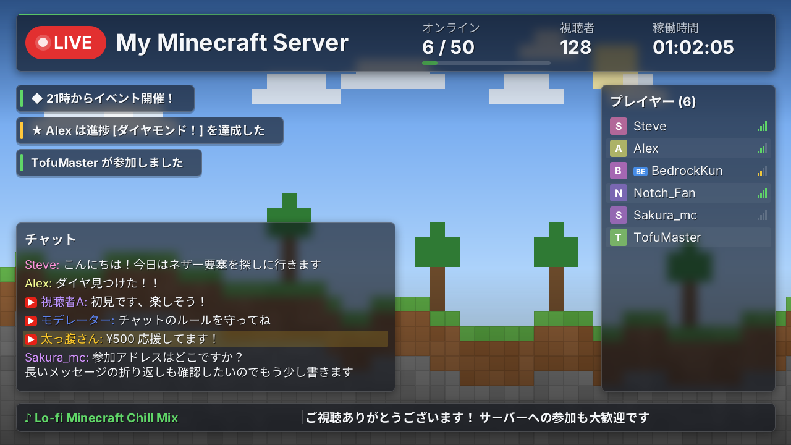

# YtStream — Minecraft → YouTube Live 自動配信プラグイン

ゲーム内で `/ytstream start` と打つだけで、サーバーの状態(オンライン人数・プレイヤー一覧・チャット・参加/退出通知・稼働時間)を載せた配信画面を **プラグイン自身が生成**し、FFmpeg経由でYouTube Liveへ送信します。OBSもブラウザ操作も不要です。

**v1.1** で **YouTube API連携** に対応しました。配信枠の作成→紐付け→「ライブ」への切替→終了までをプラグインが行うため、**YouTube Studio(配信ページ)を開いていなくても配信が確実に開始されます**。あわせて描画性能・見た目・通信の安定性を強化しました(詳細は「[v1.1 の改善点](#v11-の改善点)」)。



> **重要な前提**: 配信されるのは「背景画像+サーバー情報」で作ったオリジナル画面です。Minecraftのワールド(ゲーム画面)を撮影する機能ではありません。

## 技術構成と実現可能性

| 項目 | 方式 | 備考 |
|---|---|---|
| 対応サーバー | Paper / Purpur 1.21.x、Java 21 | Folia 非対応 |
| Java版/統合版 | Bukkit上のPlayerとして一括処理 | Geyser/Floodgate 導入環境で動作。Floodgate APIへの依存なし(名前プレフィックスで判別) |
| 映像生成 | Java2D(`BufferedImage`、外部ライブラリ不要) | 専用スレッドで描画。メインスレッドは使わない |
| エンコード/送信 | 外部の **FFmpeg**(stdinへBGR24生フレーム→x264/AAC→FLV→RTMP) | **要インストール**。ライセンス上、同梱しません |
| YouTube連携 | **YouTube Data API v3(OAuth デバイスフロー)** または ストリームキー方式 | API連携で配信枠の作成〜ライブ開始〜終了を自動化。未設定時はキー方式で動作 |
| 依存関係 | Paper APIのみ(compileOnly) | JARに外部ライブラリは入りません(JSON/HTTPもJDK標準で実装) |

### 視聴者をプレイヤーに変える機能

- **お知らせバー**(画面下部): 参加アドレス・Discord・ルールなどを順番にフェード表示(`info.messages`、`{online}` `{max}` 使用可)
- **実績/死亡の通知**: Advancement達成やプレイヤーの死亡を派手に表示(`display.events`)
- **サーバー内への配信告知**: 配信開始時と定期的に、クリックで開けるYouTubeリンクをサーバーチャットへ(`promo.*`)。配信中に参加した本人へは「チャットと名前が配信に映ります」と自動通知
- **BGM + 再生中の曲名表示**(下記)
- バニッシュ/`ytstream.hide` のプレイヤーを映さない、チャットの伏せ字、参加・退出・人数のなめらかな演出

### BGM

`plugins/YtStream/bgm/` に `mp3 / ogg / wav / flac / m4a / opus` を置くだけ。シャッフル再生・ループ・0.5秒フェードイン、配信中にファイルを足しても自動で反映されます。曲ごとに別FFmpegでデコードするため形式が混在してもOK。画面下部に「♪ 曲名」を表示します。

| コマンド | 内容 |
|---|---|
| `/ytstream bgm skip` | 次の曲へ |
| `/ytstream bgm volume <0-100>` | 音量変更(再読込で設定値へ戻る) |
| `/ytstream bgm mute` / `unmute` | ミュート切替 |
| `/ytstream bgm list` | 曲一覧 |

> **著作権に注意**: 市販曲を流すとYouTubeのContent IDで配信が止まる/収益化できない場合があります。フリーBGMやライセンス済みの曲を使ってください。

### 配信を途切れさせない仕組み(サーバー稼働中は維持)

- **自動再接続は既定で無制限**(5秒→最大60秒の指数バックオフ、±20%のゆらぎ付き)。安定して配信できた後は回数をリセット。
- **事前接続チェック**でネットワーク断を即座に検知し、**バックアップ取り込みサーバー**へも切り替え可能。API連携時は再接続しても同じ配信枠(同じURL)で継続。
- **死活監視(ウォッチドッグ)**: FFmpegが落ちなくても、送信が20秒止まる(ネットワーク断・詰まり)/映像入力の詰まり/映像スレッド停止/BGMスレッド停止を検知して自動復旧。
- **BGMが原因で止まらない**: デコードの詰まり・壊れた曲・曲なしは無音で埋め、FFmpegへの音声入力は常に実時間で流れ続けます。
- **設定ミスは再試行しない**: キー未設定・FFmpeg未導入などは即エラー表示(無限リトライで通知が荒れない)。失敗通知も間引き。
- **自動開始**(`auto-start.enabled`): サーバー起動の数秒後に自動で配信開始。起動直後にネットワークが未準備でも再接続で追いつきます。
- **後始末**: サーバー停止・プラグイン無効化・クラッシュ時もFFmpeg/デコーダが残らない設計(stdinのEOFで自己終了)。

### 性能・安定性の設計

- **メインスレッド非使用**: 描画・エンコード・プロセス監視はすべて専用スレッド。イベント受信側は固定長キューへ追加するだけ。
- **静止フレームの再利用と変化時のみ送信**: 状態変化もアニメーションもないフレームは再描画せず、FFmpegへの送信も低頻度の再送のみ(出力はFFmpeg側で一定fpsへ補完)。
- **静的レイヤー+部分再描画**: パネル・ぼかし・影は起動時に1回だけ描き、毎フレームは変化した部品の領域だけを描き直す。
- **ゼロ変換出力**: `TYPE_3BYTE_BGR` のバイト配列をそのままFFmpegへ書き込み。背景は起動時に1回生成し `arraycopy` で複製。
- **有界メモリ**: チャットは64件、通知は8件で固定。大量チャットでも破綻しません。
- **FFmpegの隔離**: エンコードは別プロセス(既定はスレッド2・`nice 10`)。FFmpegが落ちてもサーバーは無事で、指数バックオフで自動再接続します。
- **確実な後始末**: `stop`/`onDisable` で stdin を閉じてFLVを正常終了→待機→強制終了の順に停止。
- **状態管理は単一スレッド直列化**: ロック競合・状態レースを排除。


## v1.1 の改善点

すべて `config.yml` で ON/OFF・調整できます(既定値は推奨設定)。

### 「配信ページを開かないと配信が始まらない」問題の解決
ストリームキーだけで送る方式では、YouTube側で配信枠(ブロードキャスト)が用意・自動開始されないと公開されず、
**YouTube Studio の配信ページを開いたときに初めて枠が用意される**挙動に左右されていました。
v1.1 では `youtube.api.enabled: true` にすると、プラグインが YouTube Data API で次を行います。

1. 専用ストリーム(`stream-title`)を自動作成/再利用し、送信先URLとキーを取得(キーの手動設定は不要)
2. 配信枠を再利用または新規作成(自動開始ON・モニターストリームOFF)してストリームへ紐付け
3. FFmpegの送信が YouTube に届いたこと(ストリームが active)を確認してから、自分で「ライブ」へ切替
4. `/ytstream stop`・サーバー停止時に配信を「終了」(`restart` や再接続では同じ配信URLのまま継続)

視聴URLも自動取得され、サーバー内の告知(`promo`)や `/ytstream status` に使われます。
APIが使えない場合(未連携・Google障害・クォータ切れ)は `fallback-to-stream-key: true` でキー方式に自動フォールバックします。

### 通信の安定性
- **事前接続チェック**: FFmpeg起動前に送信先へ名前解決+TCP接続を確認。ネットワーク断を約0.2秒で検知して再試行へ(従来は25秒のタイムアウト待ち)
- **バックアップ取り込みサーバーへの自動切替**(`youtube.backup-ingest`): 失敗が続いたら `b.rtmp.youtube.com` と交互に試行
- **ジッター付き指数バックオフ**、安定稼働後の回数リセット秒数を設定可能
- **監視の強化**: FFmpegの送信停止に加え、映像入力の詰まりも検知。エンコード速度が1.0x未満の状態が続くと管理者へ通知
- **YouTube側の受信状態の監視**(API連携時): 「不良」になったら原因(ビットレート不足等)とともに通知
- **CBR(固定ビットレート)**: YouTube推奨。静止画面でもビットレートが安定し、低ビットレート警告を防止
- FLVのライブ向けフラグ・送信キュー拡大で、一時的な詰まりで落ちにくく
- **APIクォータ管理**: 視聴者数・チャット取得などの任意の呼び出しは予約分を残して自動停止し、配信の開始/終了に必要な分を必ず確保

### パフォーマンス
- **変化したフレームだけを送信**(`video.send-only-changed-frames`): 静止中は低頻度の再送のみ。FFmpeg側で一定fpsへ補完するため出力は常に30fps。実測で送信フレーム約78%減、FFmpegのCPU時間約30%減(720p30)
- **静的レイヤーの焼き込み**: 背景・パネル・ぼかし・影・見出し・ロゴは起動時に1回だけ描画
- **部分再描画**: 変化した部品の領域だけを描き直す(チャット更新時 約1.6ms / フル描画 約3.5ms、720p)。フル描画と1ピクセル単位で一致することをテストで保証
- `/ytstream status` に描画時間・省略フレーム数を表示

### ビジュアル
- **ガラス調パネル**(背景をぼかした半透明)・やわらかい影・ヘッダーのアクセントライン・角丸サイズ
- **テーマ追加**: `ocean` / `sakura` / `midnight` / `light`(明るいテーマでは文字色や影を自動調整)。パネル色・文字色の個別指定も可
- **ヘッダーの情報列を自由に構成**(`header.columns`): 人数ゲージ / YouTube同時視聴者数 / 稼働時間 / TPS / 時計
- LIVEバッジのなめらかな脈動、お知らせの残り時間バー
- プレイヤー一覧に **応答速度バー** と **統合版(BE)バッジ**、名前順ソート
- **ロゴ/透かし画像**(`overlay.logo`)
- YouTubeチャットは ▶ マーク付き(モデレーターは青、スーパーチャットは金色の帯)

### 機能
- `/ytstream auth`: YouTubeアカウント連携(サーバーにブラウザ不要。表示URLを手元のPC/スマホで開きコードを入力)
- **YouTubeチャットの取り込み**(`youtube.api.chat`): 配信画面とサーバー内チャットへ流す。伏せ字パターンも適用
- **同時視聴者数の表示**(`youtube.api.viewers`)
- `/ytstream notice <文>`: 配信画面にお知らせを表示(イベント告知などに)
- 配信枠のタイトル・説明・公開範囲・遅延モード・DVR等を設定可能(`{server}` `{date}` `{time}` 置換)

## 導入

1. **FFmpegを入れる**(`/ytstream ffmpeg` で確認できます)
   - Windows: `winget install Gyan.FFmpeg` / macOS: `brew install ffmpeg` / Debian・Ubuntu: `sudo apt install ffmpeg`
   - または実行ファイルを `plugins/YtStream/ffmpeg/` に置く、`config.yml` の `ffmpeg.path` に指定
2. **Linuxで文字が出ない/エラーになる場合**: `sudo apt install fontconfig fonts-noto-cjk`(日本語表示に必要)
3. `YtStream-1.1.0.jar` を `plugins/` に入れて起動
4. **送信先の設定**: 下の「YouTube API連携」(推奨)か、ストリームキーを設定(いずれか。上ほど優先)
   - 環境変数 `YTSTREAM_KEY`(推奨)
   - `plugins/YtStream/secrets.yml` に `stream-key: "xxxx-xxxx-xxxx-xxxx-xxxx"`(権限 600 推奨)
   - `config.yml` の `youtube.stream-key`(平文のため非推奨)
5. YouTube Studio 側で **ライブ配信を有効化**し、「ライブ配信」→「ストリームキー」を取得(新規チャンネルは有効化に最大24時間かかります)
6. ゲーム内/コンソールで `/ytstream start`

> ストリームキーをゲーム内コマンドで入力する機能は、コマンドログに残るため意図的に用意していません。

### YouTube API連携(配信ページを開かなくても確実に開始)

初回のみ、Google Cloud でOAuthクライアントを作成します(無料)。

1. [Google Cloud Console](https://console.cloud.google.com/) でプロジェクトを作成し、「APIとサービス」→「ライブラリ」で **YouTube Data API v3** を有効化
2. 「OAuth同意画面」を作成(外部・テストユーザーに配信用のGoogleアカウントを追加)
3. 「認証情報」→「OAuthクライアントIDを作成」→ 種類 **「テレビと入力が限られたデバイス」**
4. クライアントIDとシークレットを設定(いずれか。上ほど優先)
   - 環境変数 `YTSTREAM_CLIENT_ID` / `YTSTREAM_CLIENT_SECRET`
   - `plugins/YtStream/secrets.yml` に `youtube-client-id: "…"` / `youtube-client-secret: "…"`
5. `config.yml` の `youtube.api.enabled: true` → `/ytstream reload`
6. `/ytstream auth` を実行し、表示されたURL(クリック可)を手元のPC/スマホで開いてコードを入力・許可
7. `/ytstream start` — 以後は配信ページを開かなくても、自動で枠の用意→ライブ開始まで行われます

- トークンは `plugins/YtStream/youtube-token.properties`(権限600)に保存されます。解除は `/ytstream auth logout`
- 同意画面が「テスト」状態のアプリは、Googleの仕様で約7日ごとに再連携が必要になる場合があります(失効時は通知され、キー方式へフォールバックします)。長期運用では同意画面を「本番」にしてください(未審査アプリの警告画面が出ますが、自分のアカウントであれば続行できます)
- 既定ではプラグイン専用のストリーム「YtStream」を作るため、YouTube Studioの既定のストリームキーとは別になります。既存のキーのストリームを使いたい場合は `stream-source: key`
- クォータ(既定10,000ユニット/日): 開始〜終了は数十ユニット、視聴者数60秒間隔で約1,440/日。チャット取得は1回5ユニットのため既定で無効

## コマンド(権限 `ytstream.admin`、既定はOP)

| コマンド | 内容 |
|---|---|
| `/ytstream start` | 配信開始(FFmpeg確認→映像生成→YouTubeへ接続) |
| `/ytstream stop` | 配信終了 |
| `/ytstream restart` | 再起動 |
| `/ytstream status` | 状態、配信時間、エンコード速度、描画時間、再接続回数、YouTube連携の状態・視聴者数・受信状態・API使用量、配信URL、直近のエラー |
| `/ytstream reload` | config.yml 再読み込み(実行中の配信へは restart 後に反映) |
| `/ytstream preview` | 配信せずに現在の画面を `plugins/YtStream/preview.png` に保存(レイアウト調整用) |
| `/ytstream ffmpeg` | FFmpegの検出・動作確認、導入案内 |
| `/ytstream bgm ...` | BGM操作(skip / volume / mute / unmute / list) |
| `/ytstream auth` | YouTubeアカウント連携(`status` / `cancel` / `logout`) |
| `/ytstream notice <文>` | 配信画面にお知らせを表示 |

`ytstream.hide` 権限を持つプレイヤー(およびバニッシュ中のプレイヤー)は配信画面に映りません。

## 設定

`config.yml` に日本語コメント付きで全項目を記載しています。主な項目:
解像度/FPS/ビットレート/CBR、エンコーダ(`libx264` / `h264_nvenc` など)、変化フレームのみ送信、背景画像、テーマ(`default` / `nether` / `end` / `ocean` / `sakura` / `midnight` / `light`)、ガラス調/影/角丸、ロゴ、ヘッダー列、パーツごとの表示ON/OFFと位置(画面比の相対座標)、チャットの伏せ字パターン、自動再接続/事前接続チェック/バックアップ取り込み、YouTube API連携、FFmpegのパス。

既存の `config.yml` に新しい項目が無くても、JAR内の既定値が使われます(上書き不要)。
背景画像が無ければ内蔵のブロック風背景を自動生成します。解像度は 1280×720 / 1920×1080 などに対応(座標は相対なので崩れません)。

### 負荷の目安
720p30・2500kbps・`veryfast`・2スレッドが既定です。サーバーのCPUが厳しい場合は `fps: 15`、`preset: ultrafast`、`h264_nvenc`(GPUあり)を試してください。`/ytstream status` の「速度」が 1.0x 未満なら処理が追いついていません。

## セキュリティ

- ストリームキー・OAuthトークン・クライアントシークレットはログ/チャット/エラー表示に出しません(出力は常にマスク。`Secret` 型で保持)。FFmpegの出力に含まれるURLも伏せ字化します。
- OAuthのリフレッシュトークンは権限600のファイルに保存し、アクセストークンはメモリ上のみで保持します。APIが返した送信先URLも `*.youtube.com` であることを検証してから使います。
- 子プロセスへは引数配列で渡すためシェル経由のコマンド注入は起きません。キーの形式も検証します。
- 送信先は既定で `*.youtube.com` のみ許可(`allow-custom-host` で解除)。スキン取得先も `textures.minecraft.net` に固定(リダイレクト無効・サイズ上限)。
- 背景画像/フォントのパスはプラグインフォルダ内に限定。設定値はすべて範囲検証され、不正値は安全な値に補正されます。
- **既知の制約**: FFmpegの引数(送信URL=キーを含む)は、同一マシン上の他ユーザーがプロセス一覧から読める場合があります。サーバーは専用ユーザーで動かし、共有ホストでは `hidepid` 等を併用してください。設定ファイル内のキーの「暗号化」は、復号鍵が同じ場所にある限り実効性が低いため行わず、環境変数/権限600のファイルを推奨としています。
- **プライバシー**: チャットとプレイヤー名は公開配信に映ります。不要なら `display.chat: false`、またはブロックパターンを使ってください。

## 制限・今後

- YouTube API連携にはGoogle Cloudでのクライアント作成が必要です(上記手順)。API連携を使わない場合は従来どおりストリームキー方式で、YouTube Studio側の「自動開始」設定に依存します。
- YouTubeチャットの取得はAPIクォータの消費が大きいため、24時間配信では間隔を長めにするか無効を推奨します(クォータ残量が少なくなると自動停止します)。
- FFmpegの自動ダウンロードは、改ざん検証・配布元の信頼性・ライセンス(GPL/LGPL)の問題があるため実装していません。`/ytstream ffmpeg` がOS別の導入コマンドを案内します。
- 音声はBGMのみ(ゲーム内の音は対象外)。BGMが無い間は無音トラックを送ります。

## 拡張(テーマ/表示機能を足す)

- テーマ: `render/Theme.java` の `byName` と `SettingsLoader` の許可リストに追加
- 表示パーツ: `render/Widget.java` を実装(`region` / `renderStatic`(静的レイヤー) / `render` / `isAnimating` / 必要なら `tickHz`)して `FrameRenderer` のコンストラクタに登録。座標は `Settings.DEFAULT_LAYOUT` に追加
- 映像生成は `ServerModel`(Bukkit非依存)だけを見るため、Bukkitなしでテスト可能です

## ビルド

```bash
gradle build            # build/libs/YtStream-1.1.0.jar(Java 21)
```
GitHub Actions(`.github/workflows/build.yml`)が push / PR / タグ `v*` で自動ビルドとテストを実行し、JARをアーティファクト(タグ時はReleaseにも)として保存します。

## トラブルシューティング

| 症状 | 対処 |
|---|---|
| FFmpegが見つからない | `/ytstream ffmpeg` の案内に従い導入、または `ffmpeg.path` を指定 |
| 接続直後に切れる/Input/output error | ストリームキー誤り、YouTube Studioでライブ未有効、同キーで別配信中 |
| 接続できない | TCP 1935(rtmps は 443)の送信許可を確認 |
| 日本語が□になる | `fonts-noto-cjk` を導入、または `theme.font-file` にTTFを指定 |
| BGMが鳴らない | `bgm/` に音声ファイルがあるか `/ytstream bgm list` で確認、`audio.enabled` と `bgm.enabled` が true か、`bgm volume` を確認 |
| 速度が1.0x未満 | fps/解像度/ビットレートを下げる、`preset: ultrafast`、GPUエンコーダ |
| 配信ページを開かないと配信が始まらない | `youtube.api` 連携を有効にする(上記)。キー方式のままなら Studio の配信設定で「自動開始」をON |
| `/ytstream status` が「未公開(YouTube Studioで確認)」 | 送信は届いているがライブ化できない状態。チャンネルのライブ配信権限・年齢/子ども向け設定・著作権警告の有無を Studio で確認 |
| 「YouTube連携が失効しました」 | `/ytstream auth` で再連携(テスト状態の同意画面は約7日で失効) |
| 「接続の事前確認に失敗しました」 | DNS/ネットワーク/ファイアウォール(TCP 1935、rtmps は 443)を確認。復旧すると自動で再接続します |
| 受信状態が「不良」 | 回線の上り帯域不足。`video.bitrate-kbps` を下げるか解像度/fpsを下げる |
| YouTubeでプレビューが出ない | API連携を使うか、Studioで手動で「ライブ配信開始」を押す |
